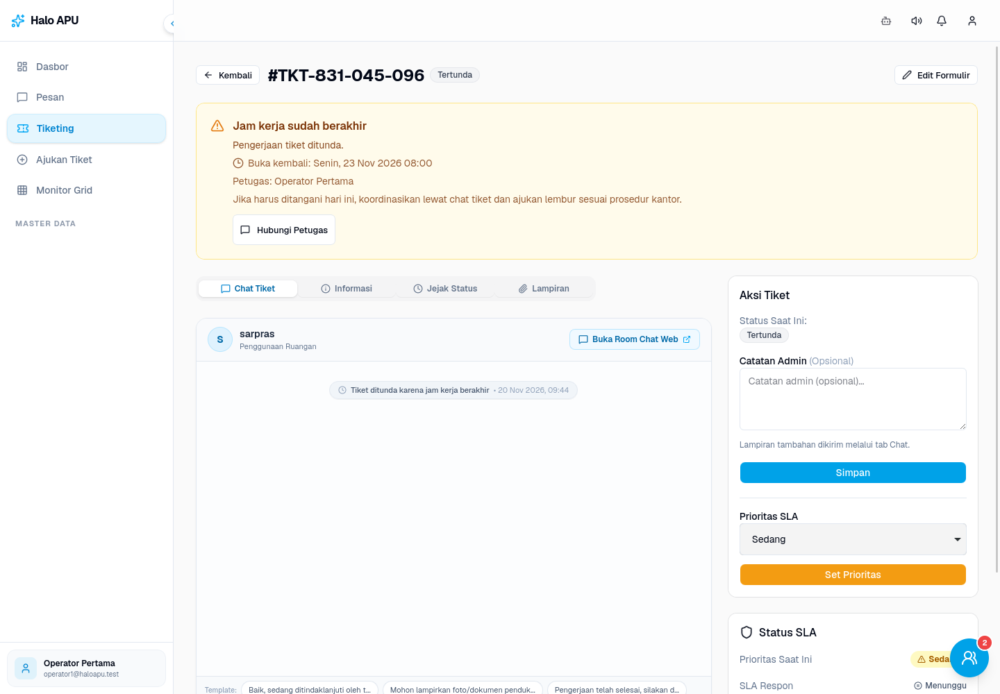
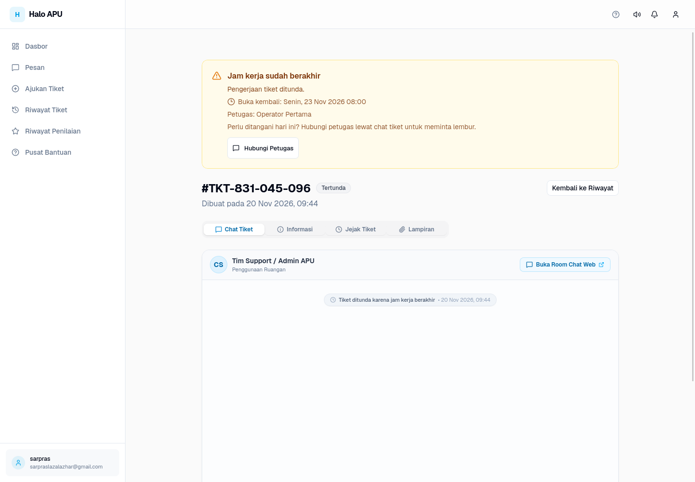
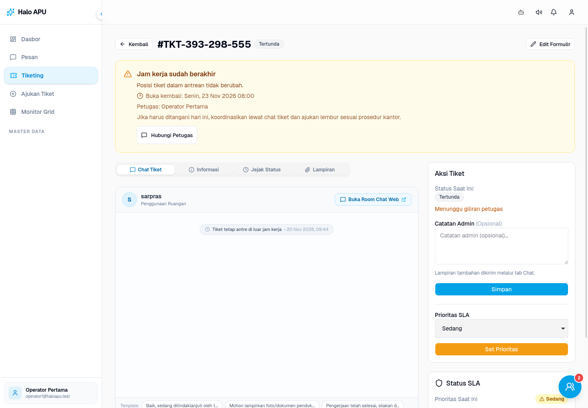
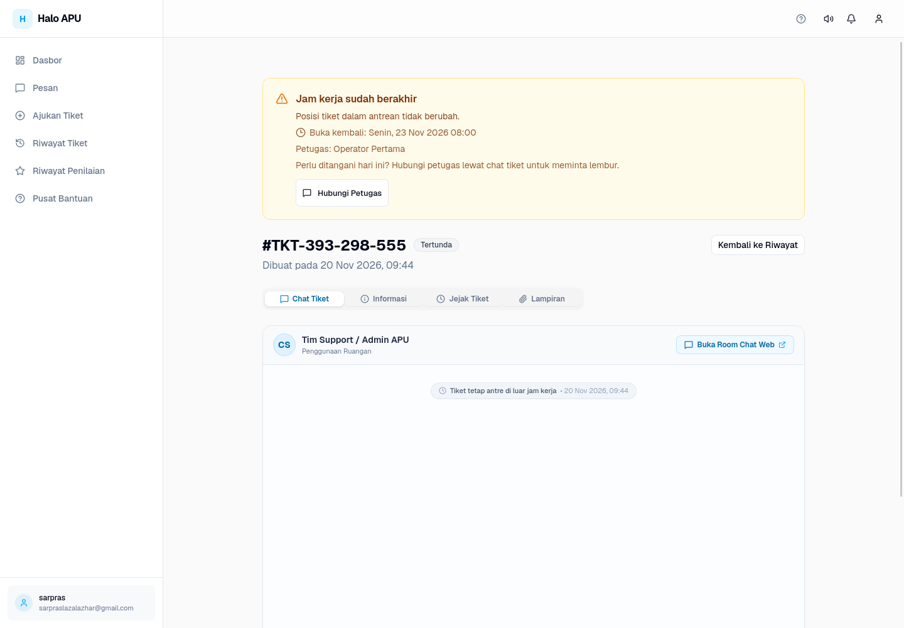
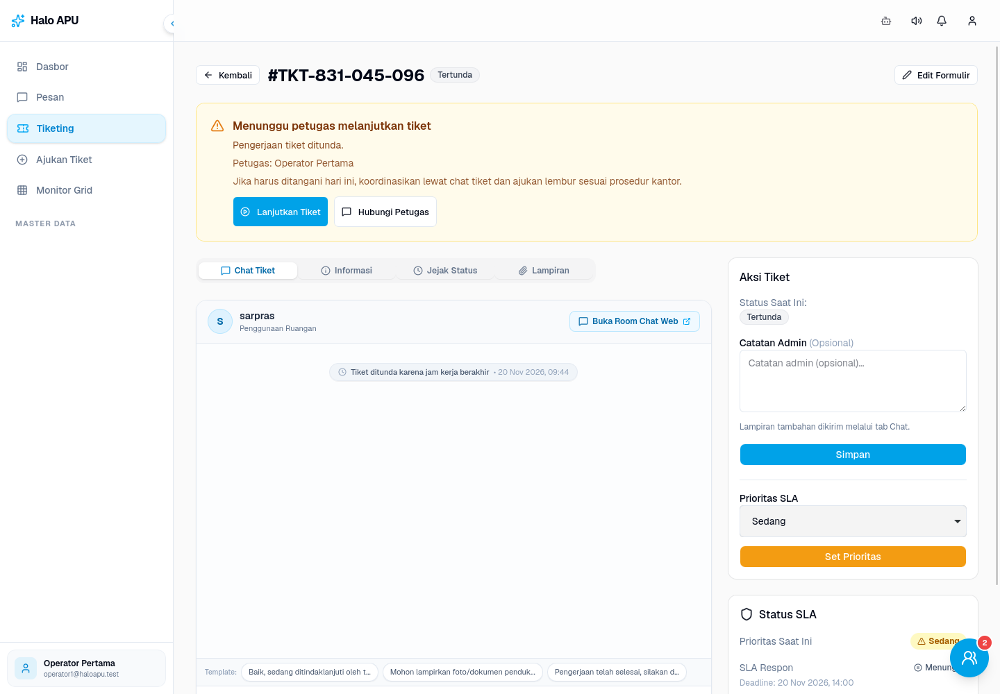
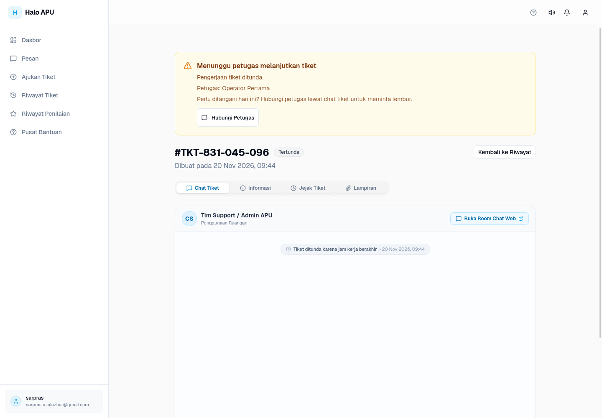
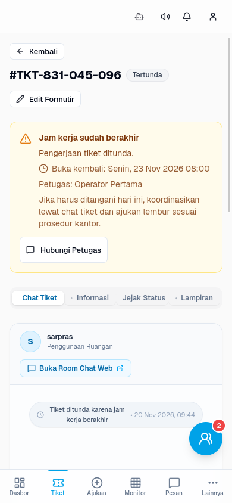
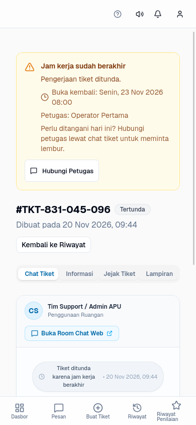
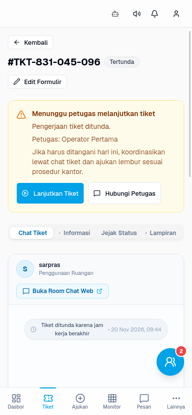

# Laporan Uji Visual: Jeda Tiket di Luar Jam Kerja

Tanggal: 20 November 2026
Lingkungan: Laravel 13.38.0, PHP 8.3.33, server lokal `127.0.0.1:8016`, browser WebKit headless
Fixture: SQLite `database/staging-visual.sqlite` (dihapus setelah uji), seeder repo, jam kerja buatan agar satu hari bisa menampilkan tutup dan buka

## Tujuan

Memastikan banner jeda jam kerja tampil benar di detail tiket admin dan pengaju, berbeda menurut peran, dan tindakan **Lanjutkan Tiket** benar-benar mengubah status.

## Data uji

| Tiket | Keadaan | Petugas | Alasan banner |
|---|---|---|---|
| `#TKT-831-045-096` | `pending`, `work_hours_resume_status = on_proses` | Operator Pertama | `paused` |
| `#TKT-393-298-555` | `pending`, `assignment_resume_status = open` | Operator Pertama | `queued` |

Akun: `superadmin`, `operator1` (petugas), `sarpras` (pengaju).
Jam kerja fixture: Jumat `08:00–09:00` (tutup pada 09:44), lalu `00:00–23:59` (buka) untuk uji lanjut.

## Hasil

| Pemeriksaan | Hasil |
|---|---|
| Banner tampil di detail admin | Lulus |
| Banner tampil di detail pengaju | Lulus |
| Teks beda per peran | Lulus, lihat tabel di bawah |
| Jam buka berikutnya tampil saat tutup | Lulus: `Senin, 23 Nov 2026 08:00` |
| `Buka kembali` hilang saat jam buka | Lulus |
| Tombol **Lanjutkan Tiket** hanya untuk petugas saat buka | Lulus |
| Tombol **Hubungi Petugas** pindah ke tab Chat | Lulus |
| Klik **Lanjutkan Tiket** mengubah status | Lulus: `pending` menjadi `on_proses` |
| Marker dibersihkan setelah lanjut | Lulus, `work_hours_resume_status = null` |
| Log `work_hours_resumed` tercatat | Lulus, 1 baris |
| Tanpa overflow horizontal 1440 px | Lulus, `scrollWidth = innerWidth = 1440` |
| Tanpa overflow horizontal 390 px | Lulus, `scrollWidth = innerWidth = 390` |
| Judul tiket satu baris di 390 px | Lulus setelah perbaikan |

Teks arahan per peran:

| Peran | Arahan |
|---|---|
| Petugas | Jika harus ditangani hari ini, koordinasikan lewat chat tiket dan ajukan lembur sesuai prosedur kantor. |
| Pengaju dengan petugas | Perlu ditangani hari ini? Hubungi petugas lewat chat tiket untuk meminta lembur. |
| Pengaju tanpa petugas | Petugas belum ditugaskan. Sampaikan kebutuhan hari ini di chat tiket. |

## Cacat yang ditemukan dan diperbaiki

1. **Header pengaju pecah di 390 px.** Nomor tiket terbelah menjadi empat baris dan mendesak badge status. Diperbaiki dengan `flex-wrap`, `whitespace-nowrap` pada nomor, dan tombol yang turun baris. Sesudah perbaikan tinggi `h1` satu baris.
2. **Pilihan "Ubah Status" masih tampil pada tiket antrean.** Pada tiket `queued`, kontrol status aktif walau transisi akan ditolak. Diperbaiki dengan `hideStatusPicker = isQueued || isWorkHoursPaused`.

## Tangkapan layar

### Admin, jam kerja tutup

### Pengaju, jam kerja tutup

### Admin, tiket dalam antrean

### Pengaju, tiket dalam antrean

### Jam kerja buka

### Lebar 390 px

## Batas uji

- Flutter tidak dijalankan di emulator; bagian mobile hanya diuji sebagai lebar 390 px di browser.
- Push ke perangkat nyata tidak diuji; hanya payload dan kanal yang diperiksa.
- Zona waktu hanya `Asia/Jakarta`.
- Fixture memakai jadwal buatan agar tutup dan buka bisa ditampilkan pada jam yang sama; produksi memakai `jam_kerja` dari halaman Konfigurasi.
- Semua gambar di laporan ini adalah tangkapan layar aplikasi sungguhan, bukan ilustrasi.
